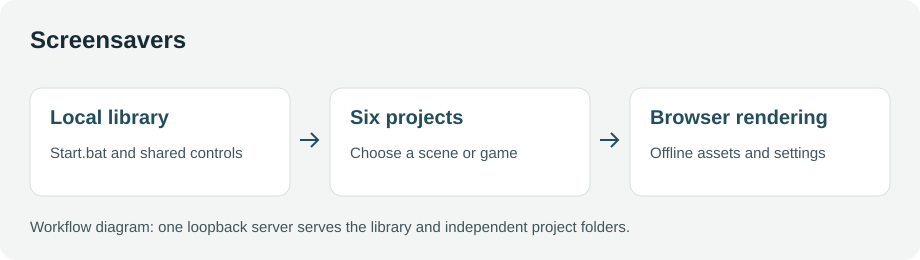
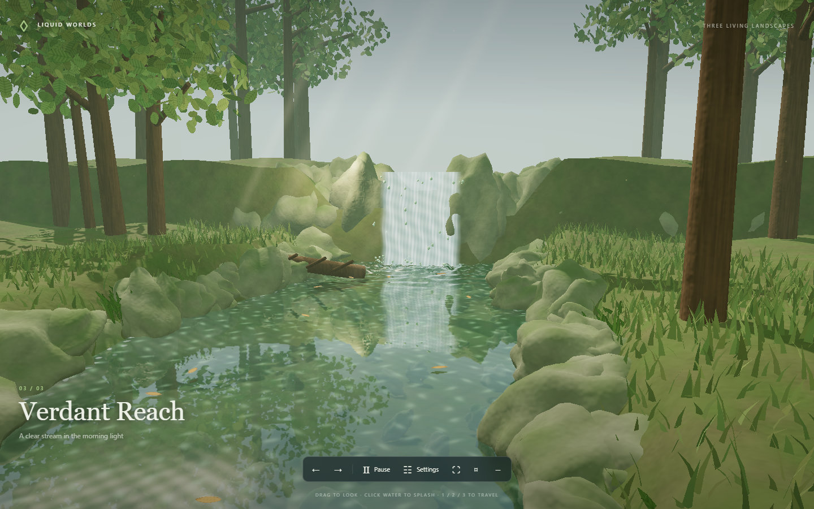
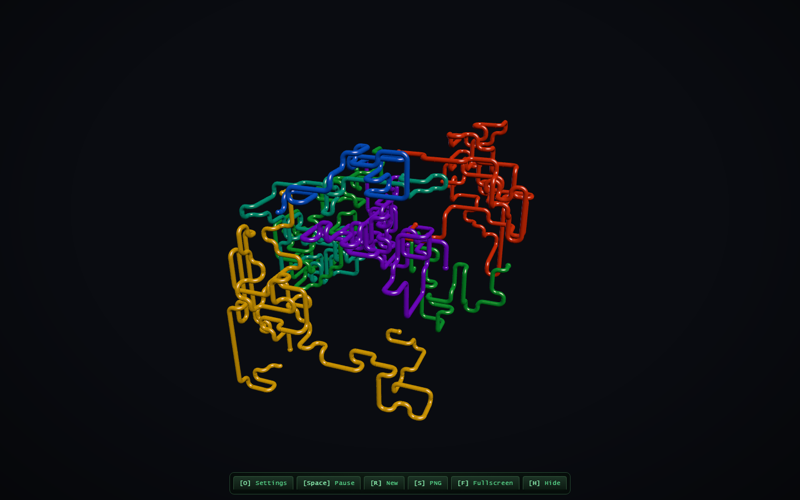

# Screensavers

## Screenshots

| Liquid Worlds | PIPELINE |
| --- | --- |
|  |  |

Six local screensavers and games: Biome Worlds, 3D Flying Objects, Liquid Worlds,
PIPELINE, Pixel Biomes, and Raycast Maze.

## Start

Double-click **Start.bat** in this folder. It starts the local server and opens
the library in your default browser. Choose any tile to open a project; use
**Library** in its control strip to return. Keep the server window open while
using the collection. Close it or press Ctrl+C to stop.

Node.js 18 or newer is required. There is no install or build step, and no
internet connection is needed. Everything is served on 127.0.0.1. An existing
collection server is reused; occupied ports are skipped. These browser
screensavers do not change Windows screensaver or power settings.

Opening index.html directly shows the library, with a reminder to use Start.bat.
The local server is required for the projects that use JavaScript modules.

## Maintenance

- npm run serve starts the server without opening a browser.
- npm run open starts the server and opens the library.
- shared/ui.css and shared/ui.js are the collection UI sources. After editing
  them, run npm run sync:ui to update the local copies in all six projects.
  The copies let each project's original static server keep working.
- With the root server running, npm run check:ui checks all six launch links,
  settings, pause/navigation controls, desktop and portrait layouts, and return
  links in an isolated installed Chrome session. This development check uses
  Python Playwright and Pillow; they are not runtime dependencies.
- Each project's original README and regression checks remain in its folder.

Only the six named projects were moved from projects-js. Its Git history retains
their original versions. The source repository's deletions are left uncommitted;
the initial collection commit belongs to this screensavers repository.
